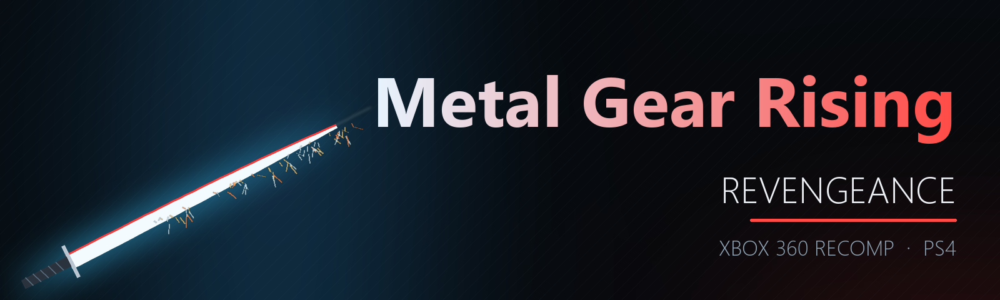

<p align="center">
  
</p>

<p align="center">
  <a href="https://github.com/iHaiDeeZ/MGR-PS4/releases/latest"></a>
  
  
  
  <a href="LICENSE"></a>
  <a href="https://discord.gg/fqjMs9gDJh"></a>
</p>

<h3 align="center">Metal Gear Rising: Revengeance, recompiled to run natively on the PS4.</h3>

<p align="center">
  <a href="https://github.com/iHaiDeeZ/MGR-PS4/releases/latest"><b>⬇ Get the latest release</b></a> ·
  <a href="#getting-started">Getting started</a> ·
  <a href="#controls">Controls</a> ·
  <a href="#the-quick-menu">Quick menu</a> ·
  <a href="#faq">FAQ</a> ·
  <a href="https://discord.gg/fqjMs9gDJh">Discord</a> ·
  <a href="CREDITS.md">Credits</a>
</p>

---

## Overview

MGR-PS4 brings [mgr-nx-deko](https://github.com/tuancapoo/mgr-nx-deko), tuancapoo's native Switch port of the Xbox 360
version of **Metal Gear Rising: Revengeance** (PlatinumGames, 2013), to jailbroken PS4 consoles. There's no emulator:
the PowerPC code of the game's `default.xex` is statically recompiled to C++ by
[ReXGlue](https://github.com/rexglue/rexglue-sdk) on your PC and compiled for the PS4's CPU. The game's Direct3D calls
are drawn by the Renut renderer through plume's **Vulkan** back end, on Mesa's RADV driver adapted to the PS4's AMD
GPU.

It's a full x86-64 conversion: none of the Switch port's ARM code (fiber assembly, fault decoding, NEON rewrites) is
carried over. The PS4 runs the SDK's x86-64 paths, built for its Jaguar CPU, with a PS4 platform layer of its own.

It installs as an app on the home screen and plays with a DualShock 4. **L3 + R3** opens a quick menu for the
resolution, the upscaling and a frame counter.

**You bring your own game.** Nothing copyrighted is in this repository or its releases: no game code, art or sound.
The package you build holds code made from your `default.xex`, so it's for your console only.

## Highlights

**The whole game, natively**
- The game's PowerPC code recompiled ahead of time and built for the PS4's Jaguar cores: no interpreter, no JIT.
- Upstream's optimised code generation (guest registers as C++ locals, constants folded from read-only data),
  without its ARM-only rewrites.
- PowerPC's fused multiply-adds as a multiply and an add: the Jaguar has no FMA unit, and the software `fma` took a
  third of the game's audio thread.
- The game's 1,202 shaders translated to SPIR-V when you build, from your own `data000.cpk`.
- Sound at 48 kHz (the game's 5.1 folded to stereo) and rumble on the DualShock 4.
- The game's own saves, kept in `/data/MGR/mgr` across updates.

**Sharp and smooth**
- Rendered at **720p** by default (360p to 1080p in the menu) and upscaled to the TV's 1080p with **FSR 1** (AMD's
  EASU + RCAS, three sharpness levels) or bilinear.
- Menus at 60 fps, gameplay at 47 to 60 in the tests so far. Real-time cutscenes run at 30, as the game sets them.
- The 360's clock on the PS4's time stamp counter (since v00.09): the game runs at its normal speed, with no frame
  skipping.

**Couch-friendly**
- The quick menu changes the picture while you play, and remembers it.
- A frame counter: frames a second, or the frame, game, render-thread and GPU times.

**When something goes wrong**
- A log for every session, ps4-kit's boot trace and its crash log (with the crashing thread's stack) in `/data/MGR/`.
- Diagnostics you can switch off in the menu: a report of the game's long waits with a check of its clock, and an
  8-second CPU profile of every thread.

## Status

| | |
|---|---|
| Boots, menus, title, gameplay | yes |
| Frame rate | menus 60; gameplay 47-60 fps (v00.07, rendering at 1080p); real-time cutscenes 30, the game's own |
| Game speed | v00.07 and v00.08 ran too fast at high frame rates: fixed in v00.09, **not confirmed on a console yet** |
| Story movies | stalled and started again in v00.07 and v00.08 (the same cause): fixed in v00.09, **not confirmed yet** |
| Tested on | one PS4 with GoldHEN |

## Getting started

**You need:** a jailbroken PS4 with **GoldHEN** and an FTP connection to it; a PC with **WSL 2** (Ubuntu, 16 GB of
RAM, about 20 GB free); the **OpenOrbis** toolchain (PacBrew); and your **own** copy of **Metal Gear Rising:
Revengeance** for Xbox 360, *Metal Gear Rising - Revengeance (USA, Europe) (En,Ja,Fr,De,Es,It,Pt)*, as a disc image or
extracted.

Its `default.xex` must have SHA-1 `2dffd4d46e727d4a64c331d54251c4d9a0a26edf` (title `4B4E080A`, version 0.0.0.4): the
code generator's configuration is made for that file. Other versions aren't supported.

> **Note:** the build also needs **ps4-kit** in `~/ps4-kit`, the shared PS4 base of these ports (toolchain setup,
> runtime, Mesa RADV for the PS4, VideoOut swapchain, packaging). This release was built with ps4-kit `79fba0f`;
> ps4-kit isn't published yet.

### Building the package

1. Install the host tools in WSL (clang 21 from [apt.llvm.org](https://apt.llvm.org) if your Ubuntu doesn't have it):

   ```bash
   sudo apt install clang-21 lld-21 cmake ninja-build git rsync python3 python3-pil \
       libwayland-dev libx11-xcb-dev libxau-dev libxcb1-dev libxdmcp-dev
   ```

2. Get the sources at the commits this port is built on, and apply the patch:

   ```bash
   mkdir -p ~/mgr-build/src && cd ~/mgr-build/src
   git clone https://github.com/tuancapoo/mgr-nx-deko && cd mgr-nx-deko
   git checkout d4bc16e && git switch -c ps4
   git apply /path/to/MGR-PS4/patches/mgr-ps4.patch
   cd .. && git clone --recursive https://github.com/rexglue/rexglue-sdk
   git -C rexglue-sdk checkout c94f5eb && git -C rexglue-sdk submodule update --init --recursive
   git clone https://github.com/renderbag/dxc-bin && git -C dxc-bin checkout 737ac9f
   ```

3. Extract your disc into `~/mgr-build/game` with upstream's extractor (or any tool that leaves `default.xex` and
   `media/` there):

   ```bash
   python3 ~/mgr-build/src/mgr-nx-deko/tools/extract_iso.py "/path/to/your.iso" -o ~/mgr-build/game
   ```

4. Build, from this repository's folder in WSL:

   ```bash
   scripts/build-mgr.sh host
   MGR_FLAVOR=optimised scripts/build-mgr.sh codegen
   scripts/build-mgr.sh shaders
   scripts/build-mgr.sh app
   MGR_VERSION=00.09 scripts/build-mgr.sh pkg
   ```

   `host` builds the code generator and the shader translator, `codegen` writes the game's C++ from your
   `default.xex`, `shaders` translates the shaders of your `data000.cpk`, `app` compiles the eboot (about 1.5 GB of
   RAM per compile job) and `pkg` makes **`out/MGR-v00.09.pkg`** (title ID `MGRR00001`, about 115 MB: the game's
   files aren't in it).

5. Copy your game (`default.xex` and `media/`, 7.3 GB) to the console's `/data/MGR/game_root`. From Windows, with
   GoldHEN's FTP server on:

   ```bash
   py scripts/upload-data.py --host YOUR_PS4_IP
   ```

6. Copy the package to the console (FTP to `/data/pkg`) and install it with GoldHEN's **Package Installer**.

> **Tip:** an interrupted upload resumes where it stopped: files already on the console with the same size are
> skipped.

**Updating:** build the newer version and install it on top of the old one. Your game files, saves and settings in
`/data/MGR/` stay.

## Controls

| DualShock 4 | Xbox 360 controller |
|---|---|
| Cross / Circle / Square / Triangle | A / B / X / Y |
| L1 / R1 | LB / RB |
| L2 / R2 | Left / right trigger |
| OPTIONS | Start |
| Touch pad click | Back |
| Left / right stick | Left / right stick |
| L3 / R3 | Stick buttons |
| D-pad | D-pad |
| **L3 + R3** | Open or close the quick menu |

## The quick menu

**L3 + R3** while playing (again, or **Circle**, to close it). The D-pad or the left stick moves, **Cross** picks.
Changes apply at once and are saved to `/data/MGR/mgr.toml` when the menu closes. The game keeps running behind the
menu, though your pad doesn't reach it while the menu is open: pause with **OPTIONS** first.

| Row | Choices |
|---|---|
| Resolution | 360p, 480p, **720p**, 1080p |
| Upscaling | **FSR 1**, Bilinear |
| Sharpness (with FSR 1) | Soft, Medium, **Sharp** |
| Frame counter | Off, **FPS**, Detailed (the frame, game, render-thread and GPU times) |
| Log the game's long waits | **On**, Off: every 30 s, the guest threads waiting 2 s or more and the game's clock against real time, in the log |
| Record a CPU profile | 8 s of play after the menu closes, every thread, to `/data/MGR/profiles/` |
| Close | Saves the settings |

The defaults are in bold.

## Your files

Everything sits in **`/data/MGR/`**:

- `game_root/`: your game (`default.xex` and `media/`), copied there by you
- `mgr/`: the Xbox 360 profile and your saves
- `mgr.toml`: the settings (the quick menu writes it)
- `logs/mgr_NNN.log`: one log for every session
- `boot-trace.log`, `crash.log`: ps4-kit's start-up trace and crash record
- `cache/`, `pipeline_list.bin`: the game folder's index and the Vulkan pipeline caches
- `shader_capture/`: shaders the game made that the build didn't have (attach them to a report: they go into the
  next build)
- `profiles/`: the CPU profiles recorded from the menu

## FAQ

**Why isn't there a package to download?**
The package holds code recompiled from the game and its translated shaders. You build it from your own copy; the
releases are source only.

**Which version of the game works?**
Only the Xbox 360 release named above, with that exact `default.xex`: the recompiled code is made for it.

**Why are some cutscenes at 30 fps?**
The game draws its real-time cutscenes at 30, on the 360 too. Menus and gameplay go up to 60.

**Why does it dip below 60 in big fights?**
The PS4's CPU is the limit there: the game's own threads and the renderer's. A lower resolution helps less than you'd
think.

**The game ran too fast, and the story movies kept stopping.**
That was v00.07 and v00.08: the 360's clock ran at a multiple of real time on the PS4. v00.09 counts the CPU's time
stamp counter instead. If you still see it, report it with your log: its `[clock]` lines compare the game's time with
real time.

**How do I report a bug?**
On [Discord](https://discord.gg/fqjMs9gDJh) or in an [issue](https://github.com/iHaiDeeZ/MGR-PS4/issues). Attach the
newest `logs/mgr_NNN.log`, `boot-trace.log` and, if there is one, `crash.log` from `/data/MGR/`, with the version,
what you were doing, your PS4 model and firmware.

## How it works on the PS4

| Part | PS4 |
|---|---|
| Game code | ReXGlue's generator writes C++ from `default.xex` on your PC (upstream's optimised flavour without its AArch64 passes); ps4-kit's clang 21 builds it for the Jaguar (`-march=btver2`) |
| Guest memory | the 360's 4.5 GB address window reserved at once; physical memory is PS4 direct memory, mapped in 64 KB chunks on first use and aliased into every mirror (`0xA0000000`, `0xC0000000`, `0xE0000000`); the 360's 4 KB protection kept on the PS4's 16 KB pages |
| Faults | FreeBSD signal frames; an allowed 4 KB page inside a closed 16 KB page is single-stepped with the trap flag |
| Threads | guest threads on PS4 pthreads with their stacks in direct memory; suspension with `pthread_suspend_np`; user APCs at alertable points; fibers by an x86-64 stack switch |
| Clock | the time stamp counter (`sceKernelGetTscFrequency` + `rdtsc`) |
| Renderer | Renut (the game's D3D calls) on plume's Vulkan back end, Mesa RADV through ps4-kit, VideoOut swapchain at 1920x1080; FSR 1 in the present |
| Shaders | XenosRecomp turns the game's 1,202 shader containers into SPIR-V at build time; RADV's pipelines are cached in `/data/MGR` |
| Sound | `sceAudioOut`, 48 kHz float stereo, one 360 audio frame (256 samples) at a time |
| Pad | `scePad` (DualShock 4) with rumble; the same pad drives the menu through ImGui |
| Files | `/data/MGR/game_root` is the game disc; the 360's storage is `/data/MGR/mgr` |

Bugs found on the way that matter for other ports of this SDK:

- **The clock.** The SDK took its tick rate from `clock_getres` and counted nanoseconds. On the PS4 (FreeBSD)
  `clock_getres` answers `1e9 / timecounter frequency + 1` ns, 2 ns here, so the 360's performance counter and system
  time ran twice as fast. The engine steps its world from that time: at 30 fps a cap on its steps hid it, at 50-60 the
  game ran too fast and the story movies (video on that clock, audio in real time) stalled. Never derive a tick rate
  from `clock_getres` on the PS4.
- **The physical window's offset.** With 64 KB allocation granularity the `0xE0000000` range has a 4 KB host offset,
  as on Windows. Every piece of code that lists Windows and Apple silicon as the hosts with the offset needs the PS4
  too: Renut's `GuestPtr` (a null D3D device at start) and the optimised flavour's D-form access macros (a null
  critical section at start).
- **The generator embeds its templates.** After a change in `sdk/resources/templates`, rebuild the host code
  generator before generating code again.
- **Thread stacks.** libkernel takes thread stacks from the app's flexible memory; 27 guest threads with 16 MB stacks
  used it up (`C0000017` from `CreateThread`), so guest stacks come from direct memory.
- **No FMA unit.** `std::fma` on the Jaguar is libm's software emulation: a third of the game's audio thread. The
  11,909 fused multiply-adds are a multiply and an add on the PS4 (`tools/ps4_unfused_fma.py`).
- **Every view readable.** The 360 reads physical memory through any of its windows; views that started at no access
  crashed Renut's shader registration.

## Good to know

- v00.09's clock fix hasn't been confirmed on a console yet (see [Status](#status)).
- The game keeps running while the quick menu is open.
- Save in the game; there are no save states. Your saves carry over to new versions.
- Only one PS4 has been tested so far. Reports from other models, and from the PS4 Pro, are welcome.

## Community

Join the **[Discord](https://discord.gg/fqjMs9gDJh)** for help, reports and news.

## Thanks

- **[tuancapoo](https://github.com/tuancapoo/mgr-nx-deko)**: mgr-nx-deko, the Metal Gear Rising port this one builds on
- **[ReXGlue](https://github.com/rexglue/rexglue-sdk)** by Tom Clay, with portions from **[Xenia](https://xenia.jp)**:
  the static recompiler and the Xbox 360 runtime
- **[sa2-nx](https://github.com/chanseyisthebest/sa2-nx)** (ChanseyIsTheBest),
  **[masseffect-nx](https://github.com/nebadasSwifty/masseffect-nx)** (NebadasSwifty),
  **[nfsmw-nx](https://github.com/StevensND/nfsmw-nx)** (StevensND) and
  **[NFSMW Recompiled](https://github.com/madelrandel-blip/NFSMW-Recompiled)** (madelrandel-blip): the ports and runtime
  work upstream builds on
- **[Renut](https://github.com/masterspike52/reNut)** and banjo-nx: the Direct3D-level renderer;
  **[plume](https://github.com/renderbag/plume)**: the graphics layer under it
- **[XenosRecomp](https://github.com/hedge-dev/XenosRecomp)** (hedge-dev): the shader translator
- **[Mesa](https://mesa3d.org)**: the RADV Vulkan driver that draws every frame
- **[AMD FidelityFX](https://gpuopen.com/fidelityfx-superresolution/)**: FSR 1
- **[OpenOrbis](https://github.com/OpenOrbis)** and **[PacBrew](https://github.com/PacBrew)**: the PS4 toolchains

Everyone involved, with licences, is listed in **[CREDITS.md](CREDITS.md)**. How the port is built and what it
changes: **[docs/DEVELOPMENT.md](docs/DEVELOPMENT.md)**.

## License and disclaimer

This repository is released under the **GNU GPL v3**, as mgr-nx-deko is. See [LICENSE](LICENSE). The upstream files
the patch changes keep their own licences (BSD-3-Clause for the ReXGlue SDK in `sdk/`, MIT for plume and FSR 1); see
[CREDITS.md](CREDITS.md).

This is a fan-made project with no ties to Konami, PlatinumGames, Microsoft, Sony Interactive Entertainment or the
authors of the projects it builds on. Metal Gear Rising: Revengeance is a trademark of Konami Digital Entertainment;
Xbox 360 is a trademark of Microsoft; PlayStation and PS4 are trademarks of Sony Interactive Entertainment. Please
only play games you own. This project won't help you find or share game files.
